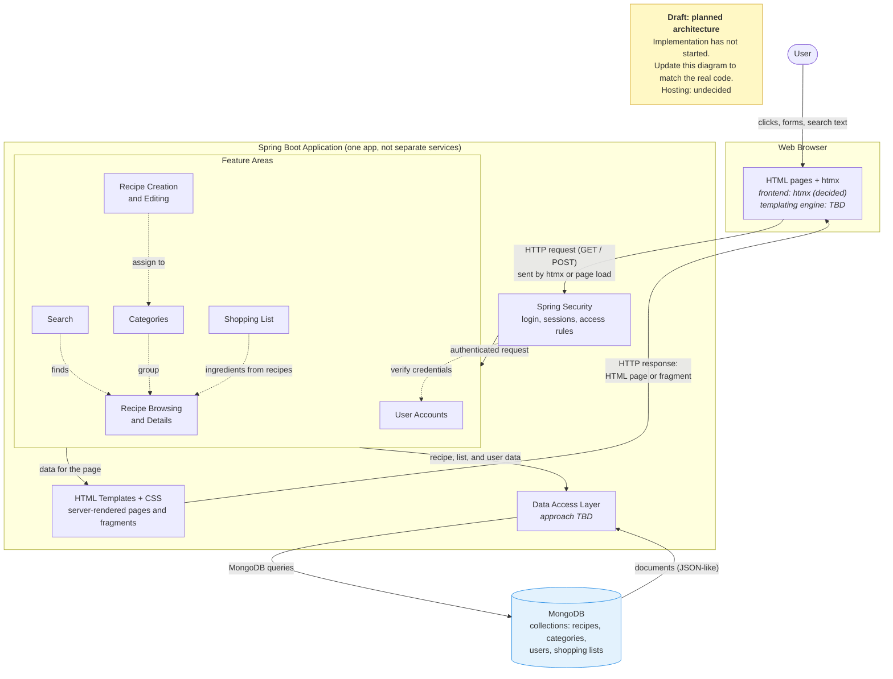

# Architecture

_Status: Draft template. Fill in as design decisions are made._

## Overview

_TODO: One or two paragraphs describing how the system works at a high level._

## Components

| Component | Technology | Responsibility |
| --------- | ---------- | -------------- |
| Backend | Java, Spring Boot | _TODO_ |
| Security | Spring Security | _TODO_ |
| Database | MongoDB | _TODO_ |
| Frontend | htmx + server-rendered HTML templates (engine TBD) | _TODO_ |

## Feature Areas

### Recipes
_TODO: What this area covers and its main responsibilities._

### Users and Authentication
_TODO: Registration, login, sessions vs tokens, roles._

### Shopping Lists
_TODO: How shopping lists relate to recipes and users._

## Diagram

This diagram shows the **planned** design and should be updated to match the implementation as the code is built.

The source file is [`architecture.mmd`](architecture.mmd). The copy below is included so GitHub displays it as a picture. **If you change the diagram, update both places.**

## Data Model

_TODO: Main MongoDB collections, what each document looks like, and what is embedded vs referenced. Add this once the team agrees on it._

## Request Flow

_TODO: Describe what happens when a user performs a typical action, from browser to database and back._

## Deployment

_TODO: Where and how the app will run (local only, or a hosting provider)._
